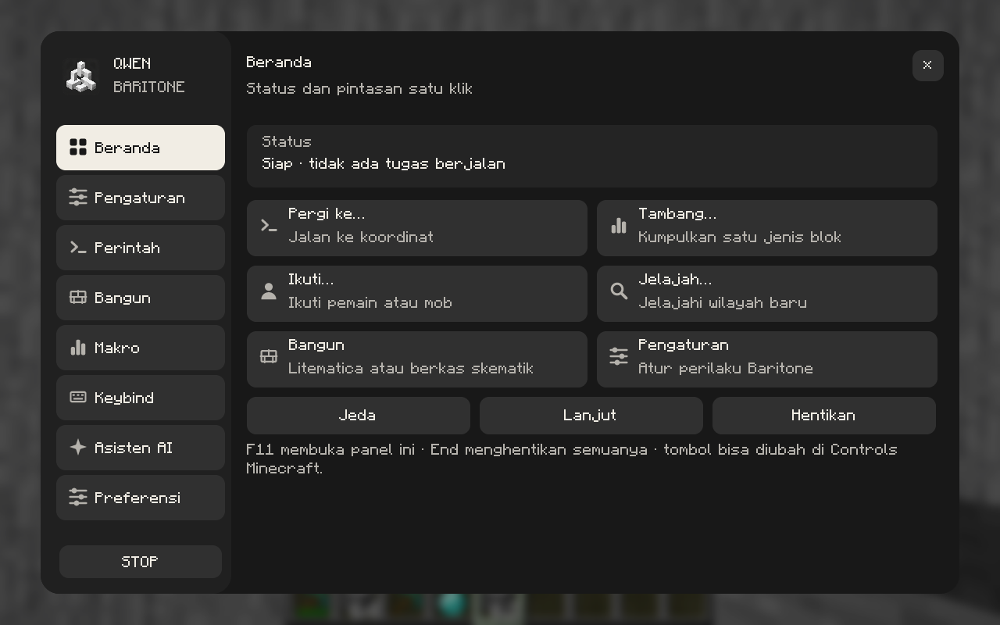

# Qwen Baritone

Fork independen [Baritone](https://github.com/cabaletta/baritone) dengan panel kontrol dalam game, makro, dan asisten Gemini opsional.

**Minecraft 26.2 · Fabric Loader 0.19.3+ · Java 25**
Rilis fork: **1.6.0-hotfix.2** · Basis Baritone: **1.19.0**



## Fitur utama

- **Panel terpadu:** pergi ke koordinat, menambang, mengikuti entitas, menjelajah, jeda/lanjut, dan STOP.
- **Perintah & pengaturan:** pencarian, kategori, formulir parameter, deskripsi, dan editor nilai aktif.
- **Bangun:** berkas skematik dan integrasi placement Litematica; Litematica/MaLiLib dipasang terpisah.
- **Makro & keybind:** urutan perintah, jeda/pengulangan terbatas, dan kombinasi Ctrl/Shift/Alt.
- **Asisten AI opsional:** chat Gemini dan aksi Baritone tervalidasi menggunakan API key milik sendiri.
- **Tampilan fleksibel:** bahasa Indonesia/Inggris, blur, ukuran panel, dan skala UI bilangan bulat. Hotfix memperbaiki logo dan benturan otomatisasi inventory dengan perpindahan item manual.

## Pasang & gunakan

1. Gunakan Minecraft **26.2**, Fabric Loader **0.19.3+**, dan **Java 25**. Cadangkan world/config.
2. Ambil JAR distribusi dari [Releases](https://github.com/Fadiba21/Qwen-Baritone/releases), atau artifact build sukses pada [Actions](https://github.com/Fadiba21/Qwen-Baritone/actions). Jangan gunakan JAR `-dev`/`-dev-shadow`.
3. Masukkan satu JAR ke folder `mods`; keluarkan Baritone/QwenUI lama agar tidak ganda. Modul Fabric minimum sudah dibundel; Mod Menu opsional.
4. Tekan **F11** untuk panel, **End** untuk STOP. Pada konfigurasi awal, fullscreen dipindahkan ke **F10**; semua tombol bisa diubah di Controls.

## Build dari source

JDK 25 wajib; Gradle sudah disertakan melalui wrapper.

```sh
git clone https://github.com/Fadiba21/Qwen-Baritone.git
cd Qwen-Baritone
./gradlew clean :fabric:clean :fabric:build test --no-daemon --max-workers=2
```

Windows: ganti `./gradlew` dengan `gradlew.bat`. JAR distribusi:
`fabric/build/libs/baritone-qwenui-fabric-1.19.0+qwenui.1.6.0-hotfix.2.jar`.
Build pertama memerlukan internet untuk dependensi. Target build yang didukung fork ini hanya **Fabric 26.2**; folder loader lain adalah warisan upstream.

GitHub Actions membangun dan menguji setiap push/PR serta menyediakan JAR dan laporan tes; build juga dapat dipicu lewat **Run workflow**. Build CI tidak menerbitkan release otomatis.

## Keamanan & batasan

AI tidak wajib untuk menggunakan panel. Saat chat AI digunakan, prompt, riwayat sesi, dan katalog fitur aktif (termasuk nilai pengaturan serta nama dan koordinat placement Litematica) dikirim ke Google. **Aksi AI yang valid langsung dijalankan tanpa konfirmasi tambahan** dan bisa mengubah world; STOP tidak membatalkan perubahan yang sudah terjadi.

API key tidak dibundel. Opsi **Ingat key** menyimpannya sebagai teks biasa di `config/qwenui.json`; jangan bagikan file itu. Jangan unggah world, log, atau konfigurasi pribadi. Lihat [kebijakan keamanan](SECURITY.md) dan [catatan pengujian](docs/TESTING.md). Tidak ada jaminan bebas bug atau kompatibel dengan semua modpack/anticheat; patuhi aturan server.

## Kontribusi & lisensi

Perbaikan komunitas diterima lewat issue dan pull request; lihat [CONTRIBUTING.md](CONTRIBUTING.md) untuk build, tes, dan sinkronisasi upstream.

**LGPL-3.0-or-later**, mengikuti [LICENSE](LICENSE); atribusi dan riwayat upstream dipertahankan. Basis: [`9fadf7c`](https://github.com/cabaletta/baritone/commit/9fadf7cf95293d7f6678981e77a939b4a7978373) pada cabang `26.2`. Nama Qwen Baritone adalah identitas fork komunitas, bukan klaim afiliasi resmi dengan pengelola Baritone, Qwen/Alibaba, atau Google.
